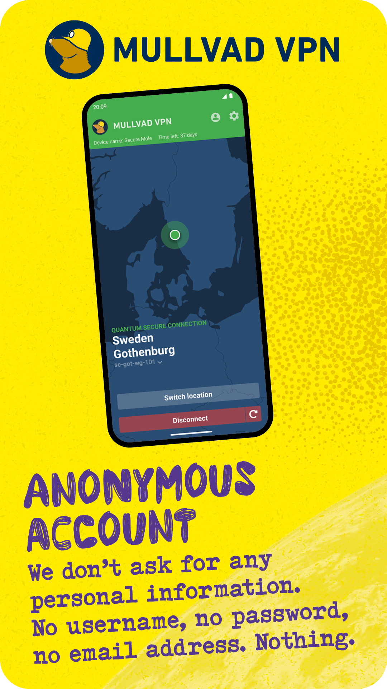
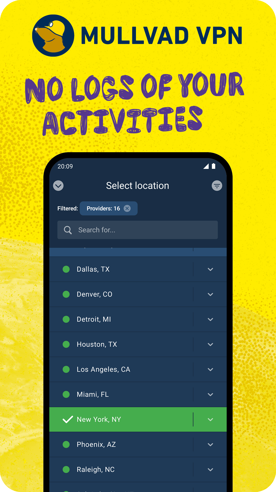
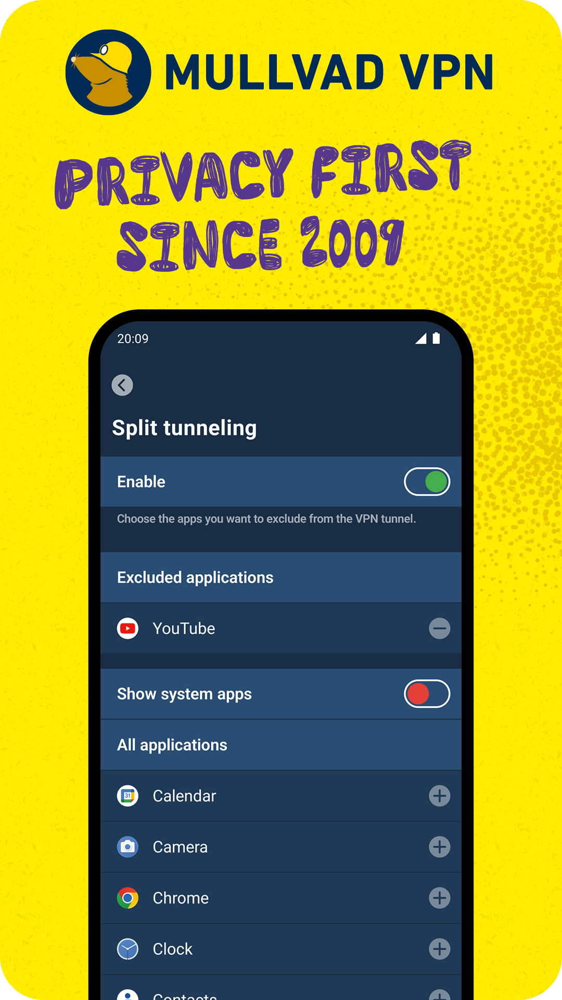

<p align="center">
  
</p>

<h1 align="center">Mullvad VPN for Android</h1>

<p align="center">
  Native Android app built with Kotlin and Jetpack Compose. Under the hood it's powered by
  <a href="https://github.com/mullvad/gotatun">GotaTun</a> and the
  <a href="../mullvad-daemon/">Rust daemon</a> we share with our desktop apps.
</p>

<p align="center">
  <a href="https://f-droid.org/packages/net.mullvad.mullvadvpn/"></a>
  <a href="https://github.com/mullvad/mullvadvpn-app/releases?q=android%2F&expanded=true"></a>
  <a href="https://play.google.com/store/apps/details?id=net.mullvad.mullvadvpn"></a>
</p>

<p align="center">
  Or get it on <a href="https://mullvad.net/download/android/">our website</a>.
</p>

<p align="center">
  
  
  
</p>

## Verifying the APK

The APK on GitHub and our website is signed with a certificate that has the following SHA-256
fingerprint:

```
7B:E2:19:30:C3:B4:D7:39:06:B0:89:30:45:0A:1D:3A:FB:D2:2C:98:D9:D8:E9:87:DF:8C:1F:BC:2D:0C:90:BB
```

To check it, run `apksigner verify --print-certs MullvadVPN-<version>.apk`. Each APK also has a
detached GPG signature (`.asc`) made with our [code signing key](https://mullvad.net/en/open-source).

## Documentation

This directory contains the Android project. Apart from the content of this directory, the Android
project also relies on building the [mullvad-daemon](../mullvad-daemon/) (which includes the GotaTun
WireGuard implementation) as a shared library bundled into the assembled APK.

All releases have signed git tags on the format `android/<version>`. For changes between each
release, see the [changelog](CHANGELOG.md).

To build the app, see the [build instructions](docs/BuildInstructions.md) or the
[build instructions for macOS](docs/BuildInstructions.macos.md). The rest of the documentation,
for example about code style, debugging and testing, can be found in the [docs](docs/) directory.

---

<sub>Google Play and the Google Play logo are trademarks of Google LLC.
The [F-Droid badge](https://f-droid.org/docs/Badges/) and the
[GitHub badge](https://github.com/Kunzisoft/Github-badge) are licensed under
[CC BY-SA 3.0](https://creativecommons.org/licenses/by-sa/3.0/).</sub>
